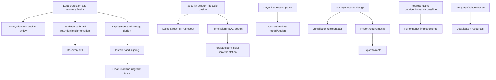

# Phase 2 Planning & Prioritization Audit

Date: 2026-09-05  
Mode: Read-only planning audit  
Decision: No implementation started

## 1. Executive Summary

Phase 1 hardening is complete at the verified technical baseline: the current Release build succeeds and the full suite reports 68/68 passing tests. Payroll calculation input integrity, lifecycle transactions, optimistic concurrency, service-boundary authorization, tax configuration validation, backup/restore validation and security regression coverage are present.

The product is not commercially ready yet. The remaining work is mostly P2 hardening, product maturity and external policy/design decisions. No new tax value, retention period, encryption policy, installer technology or business rule is invented by this roadmap.

The recommended next task is a **design/decision task**, not implementation, because the highest-impact remaining work crosses privacy, encryption, storage paths, recovery objectives and deployment operations.

## 2. Current Verified State

### Repository and runtime

- WPF executable targeting `net10.0-windows`.
- .NET SDK 10.0.302, .NET runtime 10.0.10 and Windows Desktop runtime 10.0.10 on Windows x64.
- EF Core 10 SQLite provider and `SQLitePCLRaw.lib.e_sqlite3` 2.1.13.
- Nullable reference types and implicit usings enabled.
- Application startup creates a host, applies EF migrations, opens first-run/login, then opens the main shell.
- Startup has a top-level exception path with logging and a user-facing failure message.

### Database and payroll

- Runtime database path is `AppContext.BaseDirectory/library.db`.
- Startup uses `Database.MigrateAsync()`.
- EF migrations, foreign keys, precision and unique constraints exist.
- `PayrollPeriod.Version` is an application-managed EF concurrency token.
- Payroll lifecycle and recalculation mutations use transactions and audit events.
- Paid/Closed payroll protection is present.
- Unique `(PayrollPeriodId, EmployeeId)` prevents duplicate payroll entries.
- Authoritative salary/tax/component validation is present in `SaveCalculatedAsync`.

### Security

- Passwords use `PasswordHasher<User>`; plaintext passwords are not stored.
- Inactive users and employees are rejected.
- Logout clears the in-memory session.
- Service-boundary authorization is used across major modules.
- Negative security tests cover authentication, Librarian restrictions, payroll, tax, employee/company and backup/restore boundaries.
- Permissions remain hard-coded by role name; configurable persisted RBAC is not present.

### Backup and tax

- Backup uses SQLite backup API, temporary files, integrity/schema/migration validation and validated replacement.
- Restore validates source, creates a safety backup, stages the restore and attempts rollback on failure.
- Tax rules are versioned, date-selectable, source-reference guarded and authorization-protected.
- No Haiti legal rate or formula is asserted.

### Validation evidence

- Restore: PASS, exit code 0.
- Release build: PASS, exit code 0.
- Full regression: 68/68 PASS, 0 failed, 0 skipped, exit code 0.
- Diagnostics on critical changed/runtime files: no errors found.
- No schema/model change occurred during TASK 6; EF check was therefore N/A for that review.

## 3. P2 Findings Revalidation

| Area | Current classification | Evidence | Impact | Complexity | Migration? | External decision? |
|---|---|---|---|---|---|---|
| Lockout/throttling | CONFIRMED P2 | `AuthenticationService` has no failed-attempt state | Brute-force resistance | Medium | Likely yes if persisted | Security policy |
| Password change/reset | CONFIRMED P2 | No workflow in authentication services/models | Account lifecycle/support | Medium | Possibly | Product/security policy |
| MFA | CONFIRMED P2 | No MFA infrastructure; TOTP/Admin requirement/recovery decisions approved in S1-H-D 2026-10-08 | Stronger account protection | High | Likely | S2-B secret/key protection and separate implementation gate |
| Session timeout | CONFIRMED P2 | Session is application-lifetime in memory | Stale session exposure | Medium | Not necessarily | Security policy |
| Configurable RBAC | CONFIRMED P2 | Static role-permission dictionary | Least privilege/customer administration | High | Yes | Authorization policy |
| Complete permission matrix | PARTIALLY ADDRESSED | Negative tests cover key boundaries, not every operation/role | Undetected authorization regressions | Medium | No expected | No, but acceptance matrix needed |
| Login security-event audit | CONFIRMED P2 | No login success/failure event policy | Incident investigation gap | Medium | Possibly | Audit/privacy policy |
| Database encryption at rest | CONFIRMED P2 | SQLite file and backups are not application-encrypted | Sensitive data disclosure | Medium/High | No expected | Privacy/security policy |
| Backup encryption/signing | CONFIRMED P2 | Integrity is checked, confidentiality/signing is absent | Backup disclosure/tampering | Medium | No expected | Security policy/key management |
| Backup retention/automation | CONFIRMED P2 | No scheduling/retention policy | Recovery operations | Medium | No expected | Recovery policy |
| Recovery drill | CONFIRMED P2 | Automated invalid-file tests exist; operational drill absent | Unproven disaster recovery | Medium | No | RPO/RTO decision |
| Payroll correction/reversal | POLICY DEPENDENCY | Paid/Closed normal modification is blocked; no correction workflow | Operational payroll correction | High | Likely | Business/accounting policy |
| Tax legal completeness | LEGAL/SOURCE DEPENDENCY | No authoritative legal source in repository | Compliance risk | High | Possibly | Legal/accounting source |
| Tax overlap policy | POLICY/SOURCE DEPENDENCY | Overlap is not rejected; highest version is selected | Ambiguous rule selection | Medium | Possibly | Tax-rule policy |
| Historical tax behavior | PARTIALLY ADDRESSED | Payroll values are snapshots; draft recalculation uses current applicable rule | Recalculation traceability | Medium | Maybe | Payroll policy |
| PDF/XLSX/CSV/printing | CONFIRMED P2 | No export implementation found | Customer workflow gap | Medium | No | Report requirements |
| Localization | CONFIRMED P2 | UI strings embedded in XAML/C#; no resource layer | International usability | Medium/High | No expected | Language/culture scope |
| Installer/signing/update | CONFIRMED P2 | Executables exist; no installer project/signing/update package | Distribution/support risk | High | No expected | Distribution decision |
| Database path strategy | CONFIRMED P2 | Runtime DB is beside executable | Upgrade/ACL/data durability risk | Medium | No | Deployment/storage decision |
| Accessibility/DPI/UI verification | ENVIRONMENT DEPENDENCY | Interactive WPF session unavailable | Unverified user workflows | Medium | No | Test environment |
| Performance/stress | CONFIRMED P2 | Functional tests pass; no large-data/stress baseline | Scale/latency uncertainty | Medium/High | No expected | Dataset/performance targets |
| Multi-company/tenant direction | POLICY DEPENDENCY | Current architecture is single-company | Future market limitation | High | Likely | Product/architecture decision |

## 4. Findings Resolved Since Previous Audit

- Payroll caller-supplied totals are checked against effective salary, tax configuration and components.
- Payroll recalculation and lifecycle audit mutations are transactional.
- `PayrollPeriod.Version` optimistic concurrency protection was added and stale-token behavior tested.
- Paid/Closed payroll normal modification remains blocked.
- Backup/restore now validates SQLite integrity, required schema and migration history.
- Restore uses staging, a pre-restore safety backup and rollback attempt.
- Invalid restore input and backup authorization are tested.
- Authentication/RBAC regression coverage expanded, including inactive sessions, logout, Librarian denial and payroll/tax authorization.
- Tax configuration tests cover source/rate requirements and invalid technical values.
- Current full test baseline is 68/68 PASS.

## 5. Confirmed Remaining Risks

### Security and privacy

- No lockout, throttling, MFA, password reset/change or session timeout.
- RBAC is not customer-configurable or persisted as permissions.
- Database/backups are not encrypted at rest.
- Login security events are not comprehensively audited.

### Data and operations

- Backup retention and automated backup are undefined.
- Recovery drill and operational RPO/RTO evidence are absent.
- Runtime database is stored beside the executable.
- Audit records do not provide full old/new values or tamper evidence.

### Product and deployment

- No installer, signing, upgrade or uninstall workflow.
- No export formats or localization resource architecture.
- Interactive accessibility/DPI/UI validation is not available in this environment.
- Large-data and concurrency stress testing is limited.

### Legal and business

- Haiti tax legality is not verified.
- Tax overlap behavior needs policy/source clarification.
- Paid/Closed correction workflow needs accounting/business policy.
- Multi-company/tenant direction is undecided.

## 6. Policy/Legal Dependencies

The following must not be implemented speculatively:

- Haiti rates, brackets, exemptions, deductions or contributions.
- Retention duration for employee, member, payroll and audit data.
- Encryption/key-management requirements.
- Payroll correction/reversal accounting treatment.
- Tax overlap resolution policy.
- Installer/distribution/signing choice.
- Multi-company/tenant boundary.
- Supported languages, currencies, time zones and report-localization scope.

## 7. Environment Dependencies

- Interactive Windows UI, accessibility and DPI verification require a desktop session with the application window.
- Clean-machine installation, upgrade, uninstall and signing verification require an isolated deployment environment.
- Git was unavailable in the audit environment; file-level scope review is the fallback.
- Existing Release and self-contained artifacts are present, but a full installer lifecycle is not verified.

## 8. Risk Prioritization Matrix

| Priority | Workstream | Why now | Dependency | Complexity |
|---|---|---|---|---|
| P2-A | Data protection and recovery design | Protects payroll/employee data and defines encryption, retention, paths and recovery | Privacy/security/RPO policy | High |
| P2-A | Deployment/storage strategy design | Database path, installer, signing and upgrade affect every release | Product/operations decision | High |
| P2-A | Security account-lifecycle design | Lockout, reset, MFA and timeout affect account threat model | Security/product policy | Medium/High |
| P2-B | Permission matrix and RBAC administration design | Needed before persisted configurable permissions | Authorization policy | High |
| P2-B | Payroll correction policy/design | Paid/Closed correction cannot be invented | Accounting/business approval | High |
| P2-B | Tax rule contract/legal-source design | Prevents incorrect jurisdictional behavior | Legal/accounting source | High |
| P2-B | Performance/stress baseline | Establishes scale limits before optimization | Representative datasets/targets | Medium |
| P2-C | Export/reporting | Customer-facing value after data/security contracts | Report requirements | Medium |
| P2-C | Localization | International commercial value | Language/culture scope | Medium/High |
| P2-C | Accessibility/UI verification | User quality and compliance maturity | Interactive test environment | Medium |

## 9. Dependency Graph

## 10. Proposed Phase 2 Task Sequence

### PH2-DESIGN-01 — Data Protection, Storage and Recovery Decision

- **Objective:** decide database location, encryption/key handling, backup confidentiality, retention, automation and recovery objectives.
- **Scope:** threat model, privacy inputs, data locations, RPO/RTO, backup metadata, encryption/signing decision and recovery drill acceptance criteria.
- **Out of scope:** implementation, migration, package installation, UI and legal tax work.
- **Prerequisites:** stakeholder/privacy/security decision makers.
- **Likely surfaces:** `ServiceCollectionExtensions`, `BackupService`, app configuration, deployment docs.
- **Production code expected:** No; design/documentation only.
- **Migration:** No for the design task.
- **Tests:** acceptance checklist and recovery test plan, not implementation tests.
- **Acceptance criteria:** approved storage/encryption/retention/RPO/RTO decisions and an implementation plan with explicit non-goals.
- **Risk if postponed:** sensitive local/backups data remains operationally under-specified.
- **Complexity:** High.
- **Priority:** P2-A.

### PH2-DESIGN-02 — Account Lifecycle Security Design

Lockout, throttling, password change/reset and security-event policy still need their required decisions. S1-H-D approved TOTP, mandatory Administrator MFA before General Release, and one-time recovery decisions on 2026-10-08; implementation remains gated on S2-B secret/key protection and its own task approval.

### PH2-DESIGN-03 — Configurable RBAC and Permission Matrix Design

Define persisted permission model, role administration, administrator self-lockout rules and complete role/action acceptance matrix.

### PH2-DESIGN-04 — Payroll Correction Policy and Technical Design

Define authorized correction/reversal treatment for Paid/Closed payroll, accounting effects, audit evidence and tests.

### PH2-DESIGN-05 — Tax Jurisdiction Contract and Source Review

Obtain authoritative legal/accounting sources and define jurisdiction rule semantics without inserting unverified values.

### PH2-DESIGN-06 — Deployment, Installer and Data-Path Design

Choose installer/signing/update/uninstall strategy and define application/data/log/backup locations.

### PH2-IMPLEMENT-07 — Data Protection and Recovery Controls

Implement only after PH2-DESIGN-01 acceptance; likely affects storage, backup, key management and recovery tests.

### PH2-IMPLEMENT-08 — Account Lifecycle Controls

Implement only after PH2-DESIGN-02 acceptance.

### PH2-IMPLEMENT-09 — Configurable RBAC

Implement only after PH2-DESIGN-03 acceptance; likely requires migrations and a full authorization matrix.

### PH2-IMPLEMENT-10 — Payroll Correction Workflow

Implement only after PH2-DESIGN-04 acceptance; likely requires model, authorization and audit changes.

### PH2-IMPLEMENT-11 — Tax Engine Expansion

Implement only after PH2-DESIGN-05 acceptance and legal-source review.

### PH2-IMPLEMENT-12 — Deployment Packaging

Implement only after PH2-DESIGN-06 acceptance.

### PH2-IMPLEMENT-13 — Export and Localization

Implement after report and language/culture requirements are accepted.

### PH2-VERIFY-14 — Performance, Accessibility and Release Validation

Run representative performance, interactive accessibility, deployment and recovery verification after the relevant implementations.

## 11. Recommended NEXT TASK

**PH2-DESIGN-01 — Data Protection, Storage and Recovery Decision**

This is the only recommended next task. It is design-only and must be explicitly accepted before implementation. It comes first because database location, encryption, backup retention and recovery objectives affect deployment, privacy, support and disaster recovery decisions downstream.

No implementation task should start before this design gate passes.

## 12. Explicitly Deferred Tasks

- Lockout/throttling/password reset/MFA/session timeout implementation.
- Persisted configurable RBAC implementation.
- Payroll correction/reversal implementation.
- Tax rule expansion or Haiti legal configuration.
- Backup encryption/retention/automation implementation.
- Database path migration.
- Installer/signing/update/uninstall implementation.
- PDF/XLSX/CSV/printing.
- Localization resources and language selection.
- Performance/stress optimization.
- Accessibility/UI automation.
- Multi-company/multi-tenant implementation.

## 13. Scope Exclusions

This audit did not modify production code, tests, project files, packages, EF models, migrations, database files or UI. It did not choose legal rates, retention periods, encryption algorithms, installer technology or business correction policy. It did not start TASK 7 or any implementation task.

## 14. Acceptance Gate for Phase 2 Planning

Phase 2 planning is complete when:

- every previous P2 item is classified as resolved, confirmed, partially addressed, policy/source dependent or environment dependent;
- no historical finding is silently treated as current without repository evidence;
- exactly one next task is selected;
- that task is design/decision-only where policy dependencies exist;
- implementation tasks have prerequisites, scope, tests and gates;
- no production code, schema, migration, package or behavior changed during this audit.

## Final Planning Decision

**Status: COMPLETE**

**Decision: STOP**

The roadmap is a planning artifact only. It does not authorize implementation.
